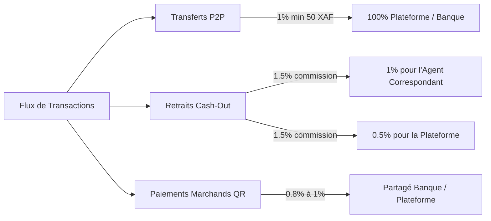

# DOSSIER STRATÉGIQUE & COMMERCIAL : YUMI PAY
**Plateforme de Mobile Money & Paiement Numérique de Nouvelle Génération**  
*Modèle Hybride Bancaire (CCEI Bank GE) — Conforme Réglementation BEAC / COBAC (CEMAC)*  
*Auteur : Ruslan Cristian ESONO MAYE — INNOTECHGE*

---

## SOMMAIRE EXÉCUTIF

1. **Présentation du Produit : Qu'est-ce que Yumi Pay ?**
2. **Architecture de Sécurité & Conformité Réglementaire**
3. **Modèle Économique & Flux de Revenus (Business Model)**
4. **Feuille de Route Commerciale Étape par Étape (Go-To-Market)**
5. **Pitch Institutionnel : Pourquoi une Banque doit adopter Yumi Pay ?**
6. **Kit de Recrutement du Réseau d'Agents (Points de Cash)**

---

## 1. PRÉSENTATION DU PRODUIT : QU'EST-CE QUE YUMI PAY ?

### Le Contexte & L'Opportunité de Marché
En Guinée Équatoriale (et dans l'ensemble de la zone CEMAC), plus de **70% de la population adulte est sous-bancarisée**, alors que le taux de pénétration des smartphones et d'Internet mobile dépasse les **75%**. La grande majorité des transactions du quotidien (achats, salaires informels, transferts familiaux entre Malabo, Bata et l'intérieur du pays) s'effectue en billets physiques, avec des risques majeurs de vol, de perte et un coût logistique élevé.

### La Solution Yumi Pay
**Yumi Pay** est une plateforme financière digitale ultra-légère, conçue pour transformer n'importe quel smartphone en guichet bancaire sécurisé.
* **Pour les Particuliers :** Ouvrir un compte en 30 secondes avec leur numéro de téléphone, envoyer de l'argent instantanément, payer des commerçants par QR code et retirer des espèces auprès de n'importe quel agent de proximité.
* **Pour les Commerçants & Agents :** Digitaliser les espèces physiques (*Cash-in*), distribuer des billets (*Cash-out*) et encaisser les clients sans terminal de paiement coûteux (TPE), tout en générant des commissions automatiques sur chaque opération.
* **Pour la Banque Partenaire (ex. CCEI Bank) :** Capter la masse monétaire informelle, accroître les dépôts à vue non rémunérés et surveiller les flux financiers via une console d'audit et de conformité en temps réel.

### Technologie Unique Multi-Plateforme
* **PWA (Progressive Web App) :** Zéro barrière à l'entrée. Accessible immédiatement par simple lien ou scan de QR code, sans téléchargement obligatoire depuis un store d'applications.
* **Application Mobile Android (Capacitor Natif) :** Présente sur le Google Play Store pour rassurer le grand public et renforcer la crédibilité institutionnelle.
* **Console Bancaire Web Haute Performance :** Interface dédiée aux équipes de conformité et de gestion des risques.

---

## 2. SYSTÈME DE SÉCURITÉ & CONFORMITÉ BANCAIRE

Yumi Pay n'est pas une simple application de messagerie ou de portefeuille gadget ; elle intègre les **standards de sécurité bancaire internationale** :

### A. Autorisation par Code PIN à 4 Chiffres
* Chaque opération débitrice (envoi d'argent P2P ou génération d'un code de retrait) nécessite la validation d'un code PIN secret à 4 chiffres.
* Le PIN est haché avec des algorithmes cryptographiques irréversibles (`pgcrypto` / bcrypt avec sel unique). Il n'est jamais stocké en clair, rendant toute interception impossible.

### B. Grand Livre Comptable en Partie Double (Double-Entry Ledger)
* Chaque centime déplacé génère deux écritures immuables (un débit et un crédit) dans la table `ledger_entries`.
* Aucun solde n'est un simple chiffre modifiable à la volée : la balance d'un compte est rigoureusement égale à la somme de ses flux validés.
* **Garantie mathématique :** Il est techniquement impossible qu'un bug crée ou fasse disparaître de l'argent.

### C. Protection Anti-Doublon & Idempotence
* Chaque requête cliente génère un identifiant unique universel (`idempotency_key`).
* En cas de coupure de réseau 3G/4G ou si l'utilisateur clique deux fois sur le bouton « Confirmer », le serveur identifie la clé et ne débite jamais deux fois le compte.
* Verrouillage strict de concurrence (`SELECT ... FOR UPDATE` au niveau PostgreSQL).

### D. Paliers de Conformité KYC (Know Your Customer) selon la BEAC / COBAC
Pour lutter contre le blanchiment d'argent et respecter les exigences de la Commission Bancaire de l'Afrique Centrale :

| Niveau | Documents Exigés | Plafond Journalier | Usage Cible |
| :--- | :--- | :--- | :--- |
| **Tier 1 (Básico)** | Numéro de téléphone + Nom | **200.000 XAF** | Particuliers, petits achats du quotidien |
| **Tier 2 (Verificado)** | DIP / Passeport / Titre de séjour validé par la Banque | **2.000.000 XAF** | Salariés, cadres, commerçants de quartier |
| **Tier 3 (Pro / Entreprise)**| NIF + Registre du Commerce + Convention signée | **10.000.000 XAF** | Grossistes, stations-service, supermarchés |

### E. Politique de Réversibilité & Protection 24h
* **Auto-Annulation (< 24h) :** Si un expéditeur fait une erreur de numéro, il peut annuler lui-même l'envoi tant que le destinataire n'a pas utilisé les fonds.
* **Réclamation Arbitrée (> 24h) :** Au-delà de 24h, une demande formelle est transmise aux agents de conformité de la banque pour médiation et blocage conservatoire.

---

## 3. MODÈLE ÉCONOMIQUE & MONÉTISATION (BUSINESS MODEL)

Le modèle économique de Yumi Pay repose sur des micro-commissions volumétriques à haute fréquence :

### Grille Tarifaire Recommandée

1. **Dépôt d'espèces (Cash-In) : GRATUIT pour le client.**  
   *Pour encourager la population à faire entrer l'argent dans le système, le dépôt ne coûte rien au client.* L'agent perçoit une commission fixe financée par le pool de liquidité.
2. **Transfert d'argent (P2P) : 1% (Plafonné à 3.000 XAF).**  
   *Gratuit en dessous de 1.000 XAF* pour favoriser l'inclusion des plus modestes.
3. **Retrait d'espèces (Cash-Out) : 1.5% du montant.**  
   * **1% revient directement à l'Agent** pour rémunérer la mise à disposition de ses billets physiques.
   * **0.5% revient à Yumi Pay / CCEI Bank.**

### Simulation de Revenus Mensuels (Exemple : 10.000 utilisateurs actifs)
* Volume mensuel traité : **500.000.000 XAF**
* Revenu brut de commissions (~1.2% moyen) : **6.000.000 XAF / mois**
* Rémunération reversée aux agents locaux : **3.000.000 XAF / mois**
* Marge nette plateforme / banque : **3.000.000 XAF / mois** (croissance exponentielle avec l'effet de réseau).

---

## 4. FEUILLE DE ROUTE COMMERCIALE ÉTAPE PAR ÉTAPE (GO-TO-MARKET)

Pour lancer commercialement Yumi Pay et signer vos premiers contrats, suivez scrupuleusement ces **5 étapes chronologiques** :

### ÉTAPE 1 : Le Partenariat Bancaire Institutionnel (Semaines 1 à 4)
En zone CEMAC, une fintech doit impérativement s'adosser à une banque disposant de l'agrément COBAC.
* **L'Interlocuteur :** La Direction Générale et la Direction des Systèmes d'Information de **CCEI Bank Guinea Ecuatorial** (ou BANGE, Société Générale GE).
* **Le Contrat Clé :** La convention d'ouverture d'un **Compte de Cantonnement (Compte Séquestre / Escrow)**. Pour chaque Franc CFA digital en circulation sur Yumi Pay, un Franc CFA réel est déposé sur ce compte à la banque.
* **L'Argument Majeur :** La banque récupère des milliards de XAF de dépôts stables sans dépenser un seul centime en construction d'agences physiques.

### ÉTAPE 2 : Intégration de la Passerelle SMS & Télécoms (Semaines 3 à 6)
Dans le secteur du Mobile Money en Afrique, le reçu SMS est l'élément qui inspire le plus confiance.
* Contracter avec un agrégateur de passerelle SMS (ex. Getesa, Muni, Infobip ou Twilio).
* Chaque transaction génère un SMS automatique :  
  *« YUMI PAY : Vous avez envoyé 10.000 XAF à +240 222... Réf : TX-9842. Nouveau solde : 45.200 XAF »*.

### ÉTAPE 3 : Recrutement du Réseau Pilote d'Agents (Semaines 5 à 8)
Le succès d'un Mobile Money dépend de la densité de ses points de cash.
* **Cible initiale :** 30 à 50 commerces à fort trafic piétonnier à **Malabo** (zones Marché Central, Caracolas, Ela Nguema) et **Bata** (Mondo, Ngolo).
* **Profil idéal :** Pharmacies, stations-service (Total, Tradex), supermarchés, boutiques de téléphonie.
* **Attribution du Float initial :** L'agent dépose 100.000 à 500.000 XAF sur son compte bancaire, qui sont crédités sur son Float de travail Yumi Pay pour commencer à recharger les clients.

### ÉTAPE 4 : Campagne d'Acquisition Client & Lancement B2B (Semaines 8 à 12)
* **Campagne d'onboarding commerçants :** Déployer les chevalets et autocollants de caisse **« Ici on accepte Yumi Pay — Payez par QR Code »**.
* **Offre de lancement :** 0 frais sur tous les transferts P2P le premier mois pour créer l'habitude d'utilisation.
* **Activation terrain :** Équipes d'ambassadeurs dans les universités et marchés pour aider les gens à créer leur compte en 1 minute.

### ÉTAPE 5 : Extension Corporate & Services à Valeur Ajoutée (Mois 3 à 6)
* **Paiement de factures :** Partenariat avec la SEGESA (électricité) et GECOMSA (eau).
* **Paiement de salaires de masse (Bulk Payroll) :** Permettre aux entreprises BTP, agricoles ou de sécurité de payer leurs employés journaliers d'un clic depuis la console Admin.

---

## 5. PITCH INSTITUTIONNEL : POURQUOI UNE BANQUE DOIT CHOISIR YUMI PAY ?

Lors de votre rendez-vous avec le Conseil d'Administration ou la Direction de la Banque, présentez ces 4 arguments majeurs :

1. **Zéro Investissement d'Infrastructure (CAPEX 0) :**  
   Ouvrir une agence bancaire physique coûte entre 50 et 100 millions de XAF. Avec Yumi Pay, chaque épicier devient un guichet bancaire à coût zéro pour la banque.
2. **Collecte de Dépôts à Vue Massifs :**  
   L'argent stationné sur les portefeuilles des clients et sur le Float des agents dort sur le compte séquestre de la banque, renforçant ses ratios de liquidité prudentiels exigés par la COBAC.
3. **Conformité & Traçabilité Intégrale :**  
   La banque dispose d'une visibilité en direct sur 100% des flux, empêchant l'anonymat suspect et fournissant des rapports d'audit prêts pour le régulateur.
4. **Souveraineté & Modernité Nationale :**  
   Une solution conçue en Guinée Équatoriale, adaptée aux réalités locales, valorisant l'expertise technologique nationale (INNOTECHGE).

---

## 6. KIT COMMERCIAL DE RECRUTEMENT D'UN AGENT CORRESPONDANT

Pour convaincre un commerçant de devenir Agent Yumi Pay, utilisez cet argumentaire simple et percutant :

> **« Monsieur le Commerçant, transformez votre boutique en Point d'Argent Yumi Pay : »**
>
> 1. **Gagnez de l'argent sur chaque opération :** Vous touchez **1% net** sur chaque retrait d'argent effectué chez vous. Si vous distribuez 200.000 XAF par jour, vous gagnez 60.000 XAF de bénéfice net par mois sans rien vendre de plus.
> 2. **Attirez de nouveaux clients dans votre magasin :** Un client qui vient retirer ou déposer de l'argent dans votre boutique achètera presque toujours des produits chez vous au passage.
> 3. **Sécurité totale :** Vous n'avez pas besoin de garder des millions en espèces. Vous déplacez votre argent entre votre compte personnel et votre caisse d'un simple geste sur votre téléphone.
> 4. **Inscription instantanée :** Aucune caution compliquée, votre compte est validé dès que vous êtes agréé.

---
*Document de référence stratégique • Yumi Pay v2.0 • Propriété intellectuelle de Ruslan Cristian ESONO MAYE (INNOTECHGE)*
