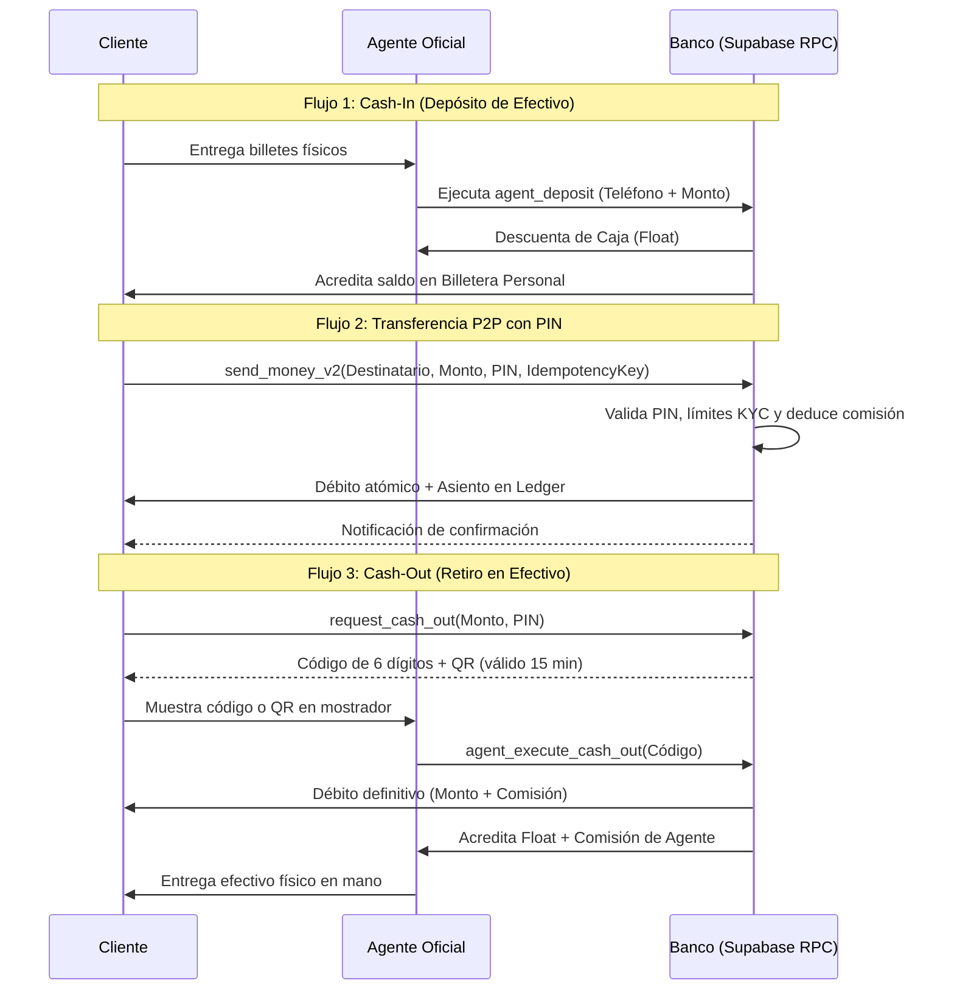

# Yumi Pay: Documentación Maestra (CCEI Bank Model) — v2.0 Banking Standard

Yumi Pay es una plataforma de **Mobile Money** de grado bancario diseñada específicamente para el contexto de **Guinea Ecuatorial** (Zona CEMAC / BEAC / COBAC), bajo un modelo híbrido inspirado en estándares bancarios como CCEI Bank GE.

---

## 1. Visión General
La plataforma permite la digitalización integral del efectivo físico y la inclusión financiera a través de una red de agentes autorizados, facilitando transferencias P2P instantáneas, pagos comerciales mediante Códigos QR y retiros de efectivo con las más estrictas garantías de seguridad, trazabilidad contable y cumplimiento regulatorio.

---

## 2. Ecosistema de Usuarios y Roles

### A. Cliente (Usuario Final)
- **Identificador:** Número de teléfono (+240...).
- **Operaciones:** 
  - Envío P2P con autorización obligatoria mediante **PIN secreto de 4 dígitos**.
  - Generación de Código de Retiro (**Cash-Out**) temporal con temporizador de 15 minutos y QR dinámico.
  - Escaneo de QR para cobros y pagos inmediatos.
  - Consulta de límites diarios en tiempo real.
  - Envío de expediente de identidad (**KYC**) para elevar límites transaccionales.

### B. Agente (Punto Oficial de Efectivo)
- **Función:** Cajero físico y corresponsal bancario de la red.
- **Sistema de Billeteras Segregadas:**
  - **Billetera Personal:** Sus fondos propios y acumulación de comisiones ganadas.
  - **Caja de Trabajo (Float):** Saldo de operaciones clientes.
  - **Traspaso Interno:** Traspaso bidireccional entre Caja y Billetera Personal.
- **Operaciones de Guichet:**
  - **Cash-In (Recarga Digital):** El agente recibe dinero físico del cliente y le inyecta saldo digital desde su Float.
  - **Cash-Out (Pago de Retiro):** El agente introduce el código de 6 dígitos del cliente (o escanea su QR), el sistema debita al cliente, acredita el Float del agente, le suma su comisión y el agente entrega el efectivo en mano.

### C. Administrador (CCEI Bank / Mesa de Control)
- **Funciones:**
  - Validación de solicitudes de nuevos Agentes y recarga de Float bancario.
  - Verificación y aprobación de expedientes **KYC** (Nivel 1 -> Nivel 2).
  - Resolución de disputas y reversiones manuales (> 24h).
  - Auditoría de transacciones y conciliación del **Grand Livre (Ledger)**.
  - Gestión y procesamiento de solicitudes de baja de cuentas.

---

## 3. Conformidad Regulatoria (BEAC / COBAC / CEMAC)

### Niveles KYC (Know Your Customer)
| Nivel | Requisitos | Límite Diario | Estado en Plataforma |
| :--- | :--- | :--- | :--- |
| **Tier 1 (Básico)** | Teléfono + Nombre | 200.000 XAF | Por defecto tras registro |
| **Tier 2 (Verificado)** | DIP / Pasaporte / Residencia verificado por Admin | 2.000.000 XAF | Aprobado tras enviar documento |
| **Tier 3 (Comercio/Pro)** | Registro Mercantil / NIF | 10.000.000 XAF | Asignado por el Banco |

---

## 4. Moteur de Frais et Commissions (Fee Engine)

- **Transferencias P2P:**
  - Menores de 1.000 XAF: **Gratis (0 XAF)**.
  - A partir de 1.000 XAF: **1%** (mínimo 50 XAF, tope máximo 3.000 XAF).
- **Retiro de Efectivo (Cash-Out):**
  - **1.5%** del monto retirado.
  - **Reparto de comisión:** ~65% para el Agente (1%) y 35% para la plataforma (0.5%).
- **Depósito en Efectivo (Cash-In):**
  - **Gratis** para el cliente (0 XAF).
  - Incentivo de comisión fija acreditada al agente.

---

## 5. Seguridad & Protocolos Transaccionales

### A. Autorización por PIN Bancario
- Cada operación financiera (envío de dinero o solicitud de retiro) requiere la verificación de un código PIN numérico de 4 dígitos haché con `pgcrypto` (bcrypt).

### B. Idempotencia y Protección Anti-Doble Gasto
- Cada transacción incluye un `idempotency_key` generado por el cliente. Si hay una reconexión de red o un doble clic, la base de datos devuelve la transacción original sin duplicar el débito.
- Uso sistemático de bloqueos `FOR UPDATE` en las funciones PostgreSQL para evitar condiciones de carrera (*race conditions*).

### C. Contabilidad en Partida Doble (Double-Entry Ledger)
- Los movimientos se registran de forma inmutable en la tabla `public.ledger_entries` (débito / crédito con saldo resultante), impidiendo cualquier desfase contable o pérdida de fondos.

### D. Ventana de Protección de 24 Horas
- **Auto-Anulación (< 24h):** El remitente puede cancelar una transferencia errónea si el receptor no ha utilizado los fondos.
- **Reversión Administrativa (> 24h):** Apertura de expediente para mediación bancaria por el Administrador.

---

## 6. Diagrama de Interacción Completo

---

## 7. Ficheros Clave del Proyecto
- [supabase/migrations/20260521000000_full_banking_compliance.sql](file:///e:/projets/mobilemoney/supabase/migrations/20260521000000_full_banking_compliance.sql) : Migración SQL completa con RPCs bancarias.
- [src/components/PinModal.tsx](file:///e:/projets/mobilemoney/src/components/PinModal.tsx) : Teclado virtual y modal de autorización PIN.
- [src/components/WithdrawModal.tsx](file:///e:/projets/mobilemoney/src/components/WithdrawModal.tsx) : Generador de código de retiro con temporizador y QR.
- [src/routes/_app/send.tsx](file:///e:/projets/mobilemoney/src/routes/_app/send.tsx) : Envío P2P con cálculo de comisión y PIN.
- [src/routes/_app/agent.tsx](file:///e:/projets/mobilemoney/src/routes/_app/agent.tsx) : Panel del agente con Cash-In, Cash-Out y comisiones.
- [src/routes/_app/profile.tsx](file:///e:/projets/mobilemoney/src/routes/_app/profile.tsx) : Configuración de PIN y subida de expediente KYC.
- [src/routes/_app/admin.tsx](file:///e:/projets/mobilemoney/src/routes/_app/admin.tsx) : Consola de validación KYC, float de agentes y auditoría.

---
*Documentación oficial de Yumi Pay • Desarrollado por Ruslan Cristian ESONO MAYE de INNOTECHGE*
